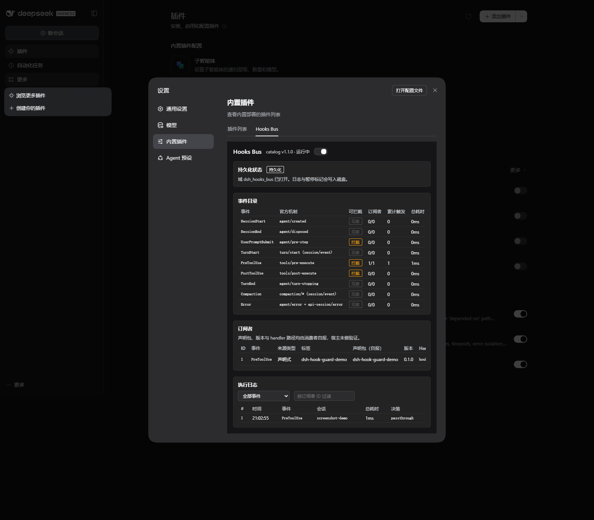

# dsh-hooks-bus

DSH 钩子总线：官方生命周期事件表面之上的**受管理订阅总线**。

> 当前包版本 **0.3.0**。已验证基线：**DeepSeek Harness `0.2.1-rc.5`**。
>
> 本包不宣称兼容全部 DSH 版本；宿主升级后请重新核对事件适配。

官方运行时（`@deepseek-ai/dsh`）已提供强类型的拦截/观察机制（`agent/pre-step`、`tools/pre-execute` 等）。本插件不重新发明拦截，而是提供管理层：

- **版本化事件目录**：友好事件名（`UserPromptSubmit`、`PreToolUse`、…）+ `catalogVersion`（当前 **1.1.0**）
- **双通道订阅**：运行时 API `ctx.hooksBus.on(...)` + 声明式清单（`package.json` 的 `hooksBus.subscriptions`）
- **执行保障**：优先级、每订阅者超时（默认 5s 可配）、错误隔离——订阅者异常**绝不透出到官方链**
- **可观测**：环形缓冲的钩子调用日志 + `stats()` 聚合；设置页（Settings → Plugins → Hooks Bus）查看事件目录、订阅者、日志，支持单个停用与全局暂停
- **持久化状态显式可见**：内存/持久化模式与 `unavailable`、`initializing`、`ready`、`error` 四种状态通过 `state().persistence` 与设置页展示，绝不把内存日志伪装成已落盘

## 安装

```sh
# 发布后，通过 DSH profile 的插件管理器安装到目标 profile：
dsh plugin --profile <profile> add dsh-hooks-bus
# 本地开发时也可以指向本仓库目录：
dsh plugin --profile <profile> add <本仓库路径>
```

安装后重启宿主，在 Settings → Plugins → Hooks Bus 页查看总线状态。

## 事件目录（catalog v1.1.0）

| 事件 | 官方机制 | 可拦截 | payload 要点 |
| --- | --- | --- | --- |
| `SessionStart` | `agent/created` | 否 | `{ sessionId, source: startup\|resume\|clear\|compact, workspacePath? }` |
| `SessionEnd` | `agent/disposed` | 否 | `{ sessionId, messageCount, durationMs? }`（messageCount 数持久化 user/message） |
| `UserPromptSubmit` | `agent/pre-step` | ✅ | `{ sessionId, turn, step, text, attachments, messages }`；block=reject，modify=替换消息批 |
| `TurnStart` | `turn/start`（session/event） | 否 | `{ sessionId, turnIndex, model? }`（model 尽力取自 request/header） |
| `PreToolUse` | `tools/pre-execute` | ✅ | `{ sessionId, toolName, args, callId }`；allow/block/cancel/ask（**参数改写官方不支持**） |
| `PostToolUse` | `tools/post-execute` | ✅ | `{ sessionId, toolName, args, result, durationMs?, callId, error? }`；block/modifyValue/modifyContent |
| `TurnEnd` | `agent/turn-stopping` | 否 | `{ sessionId, turnIndex, text?, usage? }` |
| `Compaction` | `compaction/*`（session/event） | 否 | `{ sessionId, phase, turn, compactionId?, shadowedTokenCount?, error?, data }` |
| `Error` | `agent/error` + `api-session/error` | 否 | `{ sessionId?, errorType, message }` |

**为什么没有 `Notification`**：三重证据确认运行时拿不到该事件（实时事件目录无此类事件、官方拦截笔记明确排除、官方 CC 桥不支持列表包含它）。按「不编造 API」原则从 v1 目录移除，README 在此说明。

## 快速上手（消费者插件）

```ts
import type {} from 'dsh-hooks-bus' // 使 ctx.hooksBus 获得类型
import { Context } from 'cordis'

export const inject = ['hooksBus'] // 总线未启用时 Loader 给出明确的服务缺失错误

export function apply(ctx: Context): void {
  const unsubscribe = ctx.hooksBus.on('PreToolUse', (event) => {
    if (event.toolName === 'pwsh' && isDangerous(event.args)) {
      return { action: 'block', reason: '命令被安全策略拦截' }
    }
  }, { priority: 10 })
  ctx.effect(() => unsubscribe)
}
```

完整对接文档（10 分钟上手 + 决策表 + 声明式清单 schema）见 [docs/author-guide.md](docs/author-guide.md)。

## 订阅来源（自报，不是身份验证）

运行时 `on()` 与声明式 `declare()` 都接受可选的 `owner`，用于设置页排障：

```ts
ctx.hooksBus.on('PreToolUse', handler, {
  owner: { packageName: 'my-plugin', packageVersion: '1.2.3' },
})

await ctx.hooksBus.declare(
  [
    {
      event: 'PreToolUse',
      handler: './hooks/guard.js',
      owner: {
        packageName: 'my-plugin',
        packageVersion: '1.2.3',
        handlerRef: './hooks/guard.js',
      },
    },
  ],
  { baseUrl: new URL('./', import.meta.url).href },
)
```

- `owner` 全部来自消费者**自报**。总线不读取调用栈猜测包名，也不验证包身份；设置页明确标注“声明包（自报）”。
- `handlerRef` 只接受包内相对路径。总线把它规范化为 POSIX 形式（`./hooks/guard.js` → `hooks/guard.js`）；绝对路径、盘符、URL 和逃出包外的 `..` 一律替换为 `external`，原始路径不会出现在 API、日志或设置页。
- 缺失字段在 API 中省略，设置页显示本地化 unknown。不传 `owner` 的旧消费者行为不变。
- owner 只改善排障可见性，**不是安全边界**，不构成宿主身份背书，也不用于恶意插件识别。

`state().subscriptions` 从 M2 起增加可选 `owner` 对象（既有字段不变）：

```json
{
  "id": 1,
  "event": "PreToolUse",
  "source": "declarative",
  "label": "dsh-hook-guard-demo",
  "priority": 100,
  "timeoutMs": 2000,
  "paused": false,
  "owner": {
    "packageName": "dsh-hook-guard-demo",
    "packageVersion": "0.1.0",
    "handlerRef": "hooks/danger-guard.js"
  }
}
```

## 声明式批次内顺序（before / after）

同一次 `declare()` 中、同一事件内的条目可以用 `key` + `before` / `after` 指定顺序：

```ts
await ctx.hooksBus.declare([
  {
    event: 'PreToolUse',
    key: 'audit',
    before: ['guard'],
    handler: auditHandler,
  },
  {
    event: 'PreToolUse',
    key: 'guard',
    after: ['audit'],
    handler: guardHandler,
  },
])
```

- `before: ['b']` 表示当前条目在 `b` 前；`after: ['a']` 表示当前条目在 `a` 后。
- `key` 只在**同一批次、同一事件**内唯一；引用不能跨事件、跨批次或跨包。
- 使用稳定拓扑排序。无约束条目仍按 priority 降序 + 声明顺序；DAG 与 priority 冲突时以 DAG 为准。
- 重复 key、未知引用、跨事件引用、自环或多节点环都会整批报错，不留半批订阅。
- 暂停某个节点不会改变其余节点的合法执行顺序；DAG 只决定分发顺序，不改变超时、异常隔离或 Decision 合并。
- 仅限同批次、同事件，**不是跨插件的全局 DAG/工作流引擎**。来源元数据仍是消费者自报，不因使用 before/after 获得额外信任。

## 示例（真实跑通，非 mock）

`docs/examples/` 三个示例订阅者，`tests/examples.test.ts` 在真实 Cordis 挂载上驱动官方事件验证：

- `audit-log.ts` — 审计日志（PostToolUse / TurnEnd / SessionStart）
- `danger-command-guard.ts` — 危险命令拦截（`rm -rf`、`format`、`del /s`、`git push --force` 等）
- `turn-stats.ts` — 回合统计（计数与 token 汇总）

**独立的消费者参考实现**：[dsh-hook-guard-demo](https://github.com/ENyerere/dsh-hook-guard-demo)——完全独立的包，演示 peer 依赖 + 声明式清单订阅的完整姿势（同时也是一个真能用的危险命令守卫）。

## 设置页

Settings → Plugins → Hooks Bus：



> 截图来自本轮构建的隔离 profile；为在一张图中展示持久化、事件目录、订阅者和钩子调用日志，临时展开了设置弹层的滚动区域。页面数据为安全合成事件，不含用户会话、提示词、token 或本机私密路径。

- **事件目录**：每个事件的官方机制、可拦截性、订阅者数、累计触发次数、总耗时
- **订阅者**：展示来源类型（runtime / declarative）、label、priority、timeout、单独停用/启用，以及消费者**自报**的声明包、版本和 handler 相对路径；缺失显示 unknown，包外/绝对路径只显示 external，不泄露本机路径
- **钩子调用日志**：按事件 / 订阅者 ID 过滤，显示各订阅者结果与合并决策。这里记录的是总线钩子分发，不是 DSH 会话轨迹、模型调用链或通用 telemetry
- **全局暂停**：一键直通（零开销）；日志默认只存 payload 摘要（200 字符，`logFullPayload` 可开启全文）
- **持久化状态**：日志与全局暂停写入插件自己的 storage 域（`storageDomain`，域名 `dsh_hooks_bus`——存储中枢要求域名匹配 `/^[a-z][a-z0-9_]*$/`，连字符非法）。`state().persistence` 与设置页同时展示：

| status | mode | 含义 |
| --- | --- | --- |
| `unavailable` | memory | 本部署没有 `storageDomain` 服务；日志与暂停只在内存中 |
| `initializing` | memory | 已开始等待存储服务，或 open 正在进行 |
| `ready` | persistent | 域已打开；日志与暂停会写入磁盘，重启可恢复 |
| `error` | memory | 存储服务存在但打开/恢复失败；错误摘要在 API/UI 可见，总线继续内存分发 |

## 开发

```sh
pnpm install
pnpm test           # vitest：当前全套用例（含真实 Cordis 挂载的接线、示例验证、客户端契约、持久化恢复、来源元数据）
pnpm check:client   # node --check：客户端半边语法门（client/client.js 无 TS 编译覆盖，此脚本兜底）
pnpm build          # tsdown → lib/
pnpm typecheck      # tsc --noEmit
pnpm lint           # oxlint（模板配置 + 记录在案的豁免）
```

骨架与构建配置基于 `omdsh-dev/plugin-template`（pnpm + tsdown + vitest + oxlint/oxfmt），未自行发明。

## 里程碑

- [x] M0 探针：可行性报告（《P7-M0-可行性报告》）
- [x] M1 最小核：dispatcher + registry + 5 事件 + 运行时订阅 API + 单元测试
- [x] M2 完整版：9 事件 + 声明式订阅 + 设置页 + 日志查看器 + 三个示例 + README
- [x] M3 生态验证：`dsh-hook-guard-demo` 独立插件（peer 依赖 + 声明式清单），被依赖路径在 profile 中真实激活；日志/暂停持久化落地

## 许可

MIT
